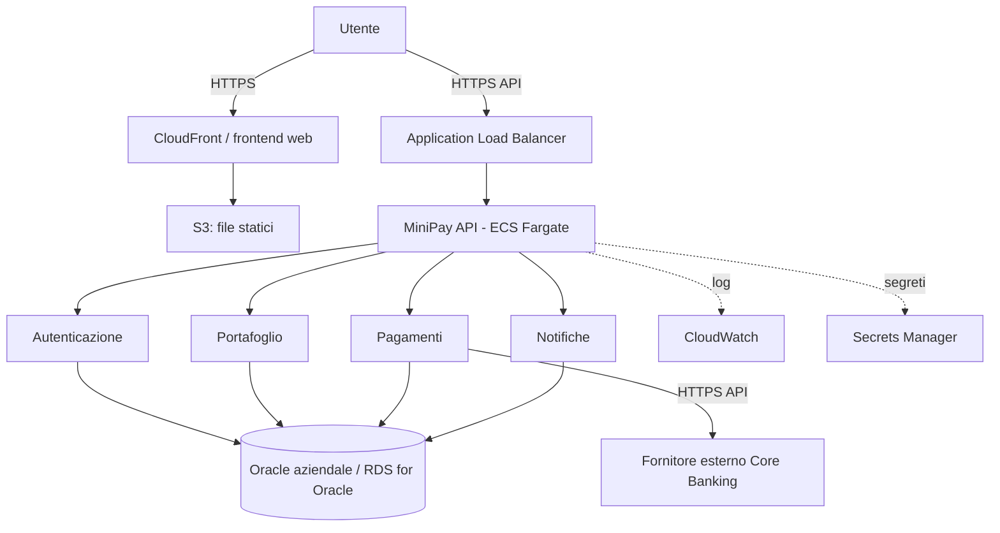

# MiniPay — macro-architettura semplificata

Questo documento traduce la consegna dell'esercizio in una proposta architetturale didattica. **Non significa che AWS o Oracle siano già attivi**: la demo eseguibile continua a usare SQLite e il mock di core banking.

## 1. Componenti e responsabilità

| Componente | Responsabilità | Dove starebbe nella soluzione AWS |
|---|---|---|
| Browser / futura app nativa | Interfaccia usata dal cliente | Browser dell'utente; app nativa opzionale |
| Frontend web | HTML, CSS e JavaScript | S3 + CloudFront (opzione consigliata per file statici) |
| API MiniPay | Autenticazione, API e coordinamento richieste | Container su Amazon ECS con AWS Fargate, dietro Application Load Balancer |
| Servizi applicativi | Regole di autenticazione, portafoglio, pagamenti e notifiche | Per la demo sono moduli nello stesso backend; in una fase futura potrebbero diventare servizi indipendenti |
| Database aziendale | Utenti, portafogli, transazioni, notifiche | Oracle gestito su Amazon RDS for Oracle, oppure Oracle aziendale raggiungibile tramite rete privata/VPN |
| Core banking esterno | Autorizzazione/gestione delle operazioni bancarie | Sistema del fornitore esterno, raggiunto tramite API HTTPS autenticate |
| Segreti e monitoraggio | Credenziali e log operativi | AWS Secrets Manager e Amazon CloudWatch |

## 2. Schema a blocchi

Aprire anche `architettura.mmd` con un visualizzatore Mermaid, oppure consultare lo schema direttamente nel README di questo progetto.

## 3. Flusso principale di un pagamento

1. L'utente apre il sito e invia una richiesta di pagamento tramite HTTPS.
2. L'Application Load Balancer inoltra la richiesta al backend MiniPay.
3. Il servizio pagamenti controlla l'utente, il destinatario e il saldo.
4. MiniPay invia una richiesta autenticata al fornitore di core banking per autorizzare l'operazione.
5. Se il fornitore approva, MiniPay registra la transazione e aggiorna i saldi in Oracle in una transazione database coerente.
6. MiniPay restituisce l'esito al frontend e registra le notifiche; log tecnici e segreti sono gestiti con servizi AWS dedicati.

La demo simula il punto 4 tramite `banking_mock.py`; con la configurazione prevista registra i dati in Oracle, mentre i test automatici usano SQLite. Il diagramma descrive la destinazione architetturale richiesta, non una distribuzione già eseguita.

## 4. Scelte semplificate per l'esercizio

- Il frontend è un sito web; l'app nativa è indicata come possibile client futuro.
- Per non complicare il progetto didattico, i servizi applicativi sono ancora moduli dello stesso processo API. Per chiamarli microservizi reali occorrerebbe separarli in processi/container indipendenti con API e deployment autonomi.
- AWS è una proposta di deployment: non sono richiesti account, credenziali o risorse AWS per eseguire la demo locale.
- Oracle è il database previsto dalla soluzione architetturale; SQLite è usato soltanto per i test locali.
- Il core banking è esterno e simulato; non vengono trasferiti soldi reali.
